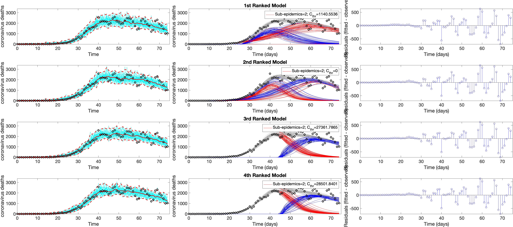

# SubEpiPredict

SubEpiPredict is a MATLAB toolbox for fitting epidemic curves and producing short-term probabilistic forecasts. It represents incidence as the sum of overlapping sub-epidemics. It ranks candidate models by the corrected Akaike information criterion (AICc), uses bootstrap refits to quantify uncertainty, and evaluates individual models and their ensembles against a flat baseline.

[Quick start](#quick-start) · [Use your own data](#use-your-own-data) · [Model settings](#model-settings) · [Forecast evaluation](#forecast-evaluation) · [Rolling origins](#rolling-origin-evaluation) · [Parameter identifiability](#parameter-identifiability) · [Output files](#output-files) · [Tutorial paper](https://doi.org/10.1016/j.idm.2024.02.001) · [Video tutorial](https://www.youtube.com/watch?v=lj_-2Kre1qw)

## Quick start

Fit the bundled U.S. COVID-19 death series through **May 11, 2020**, then forecast daily deaths for **May 12–15**. The repository includes both snapshots needed to fit the models and score their forecasts. [Fitting data][fit-data] · [Evaluation data][eval-data]

### 1. Open the toolbox

Use MATLAB with **Optimization Toolbox** (`fmincon`), **Global Optimization Toolbox** (`MultiStart`), and **Statistics and Machine Learning Toolbox** (sampling and random variates). The bundled figures were generated with MATLAB R2024a Update 6. Parallel Computing Toolbox is optional. For serial fitting, set `U.useParallel = false;` in [options_fit_settings.m][overrides].

Download and extract the repository ZIP, or clone it from a terminal.

```bash
git clone https://github.com/gchowell/SubEpiPredict-Toolbox.git
```

Set MATLAB's **Current Folder** to the repository root, then run the following. Keep the code folder current throughout the example so the routines can find `input/` and `output/`.

```matlab
cd('ensemble n-subepidemic code v1.0')
if ~isfolder('output'), mkdir('output'); end
which options -all
```

The first `options.m` listed should be in the current folder.

### 2. Fit the models and forecast four days

```matlab
areaColumn = 52;          % U.S. series in the bundled file
origin = '05-11-2020';    % Last observation available for fitting
horizon = 4;              % Four daily observations
weightCode = -1;          % Equal ensemble weights

Run_Fit_subepidemicFramework(areaColumn, origin);
[ranked, ensembles, baseline, byHorizon] = ...
    plotForecast_subepidemicFramework(areaColumn, origin, horizon, weightCode);
```

The fit searches one- and two-component models and retains up to four configurations. The forecast call writes the predictions to `output/` and returns scores. You can reuse the saved fit to try another horizon or weighting scheme.

### 3. Read and check the result

The last four rows of the best-ranked model’s forecast CSV contain the target dates, observed deaths (`data`), predictive median (`median`), and lower and upper 95% prediction limits (`LB`, `UB`). Read those rows and compare every model’s score over the same dates.

```matlab
file = ['ranked(1)-onsetfixed-0-flag1-1-method-3-dist-3-horizon-4-' ...
        'daily-coronavirus-deaths-USA-area-52-05-11-2020.csv'];
forecast = readtable(fullfile('output', file));
disp(forecast(end-horizon+1:end,:))

fourDay = byHorizon(byHorizon(:,2) == horizon, [1 3 6 7]);
disp(array2table(fourDay, 'VariableNames', ...
    {'ModelCode','MAE','WIS','RelativeWIS'}))
```

**Expected results.** The observed counts for May 12–15 are **1,589, 1,735, 1,773, and 1,665**. The baseline repeats the mean of the last seven fitting observations (**1,675.71** deaths per day), so its four-day mean absolute error (MAE) is **63.5**. Find it in `baseline(1)` or in the `ModelCode = 0` row. Code `1` denotes the best-ranked model and `100 + k` denotes the ensemble of ranks 1 through *k* (for example, `102` pools ranks 1 and 2). A relative weighted interval score (WIS) below 1 favors the model over the baseline.



*Fits through May 11. Each row shows one retained model. To inspect the plots in MATLAB, run `plotFit_subepidemicFramework(areaColumn, origin)`. This also writes the parameter diagnostics.*

## Use your own data

1. Place a numeric, header-free text file in `input/`. Use one row per regularly spaced observation and one column per area or group. Keep dates in the configuration. The loader treats every column, including the first, as observations.
2. In [options.m][fit-options], set `outbreakx` to the column to fit (`1` for a single series) and `datevecfirst1` to the date of row 1 as `[year month day]`. Set `DT` to `1` for daily, `7` for weekly, or `365` for annual observations. One forecast step is one observation interval.
3. Match the filename to `caddisease`, `datatype`, `cadregion`, and `caddate1`, as shown below. The fitting snapshot must end at the forecast origin. The single-origin fit reads the selected file through its last row.
4. Choose the forecast horizon and evaluation setting in [options_forecast.m][forecast-options]. Use `getperformance = 0` to issue a forecast with future observations left blank (`NaN`). For retrospective scoring, use `getperformance = 1` and set `datevecend1` in `options.m` to the date of a later snapshot with the same first row date and column layout and enough observations for the full horizon. Set this date before fitting. When you change the evaluation snapshot date, rerun the fit so the ranked MAT files carry the new `datevecend1`.

| Values in each column | `cumulative1` | Filename in `input/` |
|---|---:|---|
| New events per interval | `0` | `<frequency>-<disease>-<datatype>-<region>-<mm-dd-yyyy>.txt` |
| Cumulative events | `1` | `cumulative-<frequency>-<disease>-<datatype>-<region>-<mm-dd-yyyy>.txt` |

For example, `weekly-influenza-cases-ExampleRegion-03-31-2024.txt` describes weekly incident cases (`DT = 7`, `cumulative1 = 0`) with `caddisease = 'influenza'`, `datatype = 'cases'`, `cadregion = 'ExampleRegion'`, and `caddate1 = '03-31-2024'`. With the options set, call `Run_Fit_subepidemicFramework()` and then `plotForecast_subepidemicFramework()` to use those settings. The fit driver also accepts a vector of columns to fit independently.

**Cumulative counts.** The loader computes `[C(1); diff(C)]`, so it treats the first cumulative total as the first interval's count. If that total includes events before the series starts, supply interval counts. Check for missing values and negative revisions before fitting a count likelihood.

**Calibration window.** The fitter takes up to the last `calibrationperiod1` rows and begins at the first positive count in that window. The example requests 90 observations and uses all 75 available. A multi-component search requires at least 10 retained observations. Each candidate also needs more than `k + 1` observations for its AICc calculation, where `k` is its parameter count.

## Model settings

Change the assignments inside these functions. The fit and forecast entry points read them when called.

| File | What to set | Bundled example |
|---|---|---|
| [options.m][fit-options] | Data, calibration window, growth and observation models, search size, bootstrap refits | Generalized logistic growth, negative-binomial likelihood (`method1 = 3`, `dist1 = 3`), `numstartpoints = 20`, `B = 40` |
| [options_forecast.m][forecast-options] | Horizon, evaluation, ensemble weighting, retention of forecast MAT files | Four steps, `getperformance = 1`, equal weights, `deletetempfiles = 1` |
| [options_fit_settings.m][overrides] | Parallel fitting, seed, bounds, optimization and diagnostic thresholds | Parallel starts enabled. Other fields inherit the [built-in defaults][fit-settings], including `rngSeed = 1` |
| [options_Rt.m][rt-options] | Generation-interval distribution and history required to estimate the effective reproduction number | Gamma distribution, `minGIcoverage = 0.99` |

A **component** is one sub-epidemic within a fitted curve. An **ensemble member** is a complete fitted model. In the example, `npatches_fixed = 2` permits one or two components. Different onset thresholds can produce several two-component candidates, so `topmodelsx = 4` can retain four distinct models. `Ensemble(4)` pools the forecasts of the first four ranks when all four are available.

With `onset_fixed = 0`, a later component starts when its predecessor reaches a candidate cumulative count. With `onset_fixed = 1`, all components start together. The fitter ranks admissible configurations by increasing AICc. For rank *k*, the evidence ratio `exp((AICc_k − AICc_1)/2)` expresses relative support for rank 1 versus rank *k*. The default threshold of 100 triggers a warning and retains the weaker model. Attributing a fitted component to a location or transmission event requires independent evidence.

<details>
<summary>Growth equations, estimation methods, and optimization settings</summary>

`flag1` selects the growth equation for every component. Here `C` is its cumulative count, `r` its growth rate, `p` its growth-scaling exponent, `K` its carrying capacity, and `a` its shape parameter. [Growth equations][kernel]

| `flag1` | Model | Active component's `dC/dt` |
|---:|---|---|
| 0 | Generalized growth | `r C^p` |
| 1 | Generalized logistic | `r C^p (1 − C/K)` |
| 2 | Generalized Richards, outer-power form | `r C^p (1 − C/K)^a` |
| 3 | Logistic | `r C (1 − C/K)` |
| 4 | Richards | `r C (1 − (C/K)^a)` |
| 5 | Gompertz | `r C log(K/C)` |

`method1` selects the fitting objective. `dist1` selects the noise model used to generate bootstrap observations and future observations. Here `μ` is the fitted mean, `α` is dispersion, and `d` is a fitted variance exponent.

| `method1` | Objective | `dist1` and sampling model |
|---:|---|---|
| 0 | Unweighted least squares | `0` normal, `1` Poisson, or `2` negative binomial with variance `factor1 × μ` |
| 1 | Poisson likelihood | `1` Poisson |
| 3 | Negative-binomial likelihood | `3`, variance `μ + αμ` |
| 4 | Negative-binomial likelihood | `4`, variance `μ + αμ²` |
| 5 | Negative-binomial likelihood | `5`, variance `μ + αμ^d` |
| 6 | Least absolute deviations | `6` Laplace or `1` Poisson |

For methods 1, 3, 4, and 5, `options.m` selects the matching `dist1`. These likelihoods use raw counts by default. The example's seven-point moving average helps define the candidate onset thresholds. For methods 0 and 6, `smoothfactor1` also controls the moving average used in the objective. Set the span to 1 to fit the original observations. [Fitting-series selection][fit-series]

`numstartpoints` controls the candidate search. The default uses an accepted solution from the preceding threshold as a starting point when available. A search without this starting point uses `firstThresholdStartFactor = 3` times the usual number of starts. `bootstrapStarts` controls additional starts for each bootstrap refit. [Annotated settings example][settings-example]

To inspect a three-component generalized logistic trajectory with threshold-triggered onset, run the following. For direct simulation, see [simulateSubepidemic.m][simulator].

```matlab
plot_nsubepidemic(1, [0.18 0.18 0.18], [0.98 0.98 0.98], [], ...
    [10000 5000 1000], 3, 100, 1, 220, 0);
```

</details>

## Forecast evaluation

The forecast routine propagates each usable bootstrap parameter vector and generates 20 observation-noise realizations per trajectory. The resulting prediction intervals include uncertainty in the trajectory and variation in future observations. `Ensemble(k)` samples trajectories from the first *k* ranked models. Rounding the number drawn per member can omit a low-weight model when the sample is small.

| `weight_type1` | Ensemble weights |
|---:|---|
| `-1` | Equal weights (default) |
| `1` | Akaike weights proportional to `exp(−(AICc_k − AICc_min)/2)` |
| `0` | Compatibility setting. Returns the same Akaike weights as `1` and issues a warning. Older versions used reciprocal AICc |
| `2` | Weights proportional to the reciprocal of each model's calibration WIS. Scores must be finite and positive |

The weighting helper also accepts code `3`. The current forecast driver passes the **calibration WIS** to both score inputs on its active execution path, including at each rolling origin. Code `3` therefore produces the same weights as `2` in these workflows. Use `2` to specify calibration-WIS weighting explicitly. [Forecast driver][forecast-driver] · [Weight calculations][weights]

With scoring enabled and a positive horizon, the forecast function returns four numeric arrays. With `getperformance = 0`, it writes predictions and returns empty forecast-score arrays.

| Return value | Columns in order |
|---|---|
| `ranked` | Rank, MAE, mean squared error (MSE), 95% prediction interval coverage (%), WIS, AICc, relative likelihood |
| `ensembles` | Ensemble size, MAE, MSE, 95% coverage (%), WIS |
| `baseline` | MAE, MSE, 95% coverage (%), WIS over the full horizon |
| `byHorizon` | Model code, horizon, MAE, MSE, 95% coverage (%), WIS, WIS relative to baseline |

A row with horizon `h` scores **leads 1 through h together**. Lower MAE, MSE, and WIS indicate better performance. Relative WIS is the model's WIS divided by the baseline's WIS at the same horizon and requires a finite, positive denominator. Coverage is the percentage of observations inside the nominal 95% prediction interval. With four targets, each observation changes coverage by 25 percentage points.

The daily baseline repeats the mean of the last seven observations. The weekly and annual baselines repeat the last observation. Historical errors of that rule supply its lead-specific intervals. With too little history for intervals, the toolbox reports the baseline's MAE and MSE. For ranked models and ensembles, point-error scores use the median of propagated model trajectories. The `median` in a forecast CSV includes observation noise, so computing MAE from that column can give a different result. [Scoring functions][performance]


*Equal-weight ensemble forecasts from May 11. The bundled figure uses a 30-day horizon. The quick start above uses four days. Shading shows 95% prediction intervals for observed counts.*

### Rolling-origin evaluation

To compare forecasts issued on several dates, keep `getperformance = 1` and provide a later snapshot covering the last target date. Run this example from the code folder with the bundled settings.

```matlab
origins = {'05-11-2020', '05-25-2020', '06-08-2020'};
R = subepidemicRollingForecast(origins, 4, 52, -1, 'quiet', true);
disp(R.statusColumns)
disp(R.status)
if ~isempty(R.summaryFile), disp(readtable(R.summaryFile)); end
```

- **Input at each origin.** The runner uses an existing, correctly sized snapshot. If it is missing, it writes one by truncating the later series. A truncated series includes any subsequent reporting revisions. Use archived snapshots to assess what could have been forecast with data available on each issue date.
- **Resuming a run.** The runner reuses complete fits with compatible settings and fit revisions. If you replace observations under the same filename or change the evaluation snapshot date, pass `'refit', true` to fit them again. The first replaced fit is backed up in `output/replaced-by-rolling/` by default.
- **Reading the scores.** `R.scoresFile` contains one row per scored origin, model, and horizon. `R.summaryFile` reports performance across origins, including WIS and coverage for lead *h* alone as well as leads 1 through *h*. The ratio of mean WIS uses paired origins. The typical ratio is the geometric mean of positive paired ratios. A tie contributes half to the share of origins won. Check `R.status`, `R.notes`, and the number of scored dates per model before comparing ranks. Nearby origins can share forecast targets. [Rolling forecast][rolling] · [Summary calculations][rolling-summary]

## Parameter identifiability

The toolbox generates `B` synthetic datasets for each retained configuration and refits its parameters with the component count and onset threshold held fixed. The resulting 95% bootstrap intervals describe **practical identifiability conditional on that configuration**. Inspect the fitted estimate, interval width, and frequency of hitting a bound together. Structural identifiability requires a separate analysis.

After `plotFit_subepidemicFramework`, open `output/PII-topRanked-*.csv` to compare all ranks, or `PII-ranked(k)-*.csv` for rank *k*.

| Columns | Interpretation |
|---|---|
| `estimate`, `median`, `CI_LB`, `CI_UB` | Observed-data fit, bootstrap median, and 2.5th and 97.5th bootstrap percentiles |
| `PII` | Parameter identifiability index, `log10(CI_UB / CI_LB)`. A value of 1 means a tenfold interval. A nonpositive lower limit gives `NaN` |
| `PII_ratio` | Fraction of the search width occupied by the interval on the selected scale. For log scale, `PII / PII_box`. For linear scale, `PII_rangeFrac`. The default warning begins at 0.50 for a free parameter |
| `PII_scale`, `PII_box`, `PII_rangeFrac` | Selected scale (`1` logarithmic, `0` linear), full log width of positive bounds, and interval width divided by the linear search width |
| `fracLB`, `fracUB`, `bound_LB`, `bound_UB` | Fraction of refits near each bound and the bounds used. The default hit tolerance is 0.1% of the absolute bound value |
| `MCSE_PII`, `MCSE_CI_LB`, `MCSE_CI_UB` | Monte Carlo standard errors for the PII and interval endpoints |
| `fixed` | `1` identifies a parameter held fixed during fitting |

For example, `PII_ratio = 0.60` means the interval spans 60% of the allowed width on the selected scale. A large `fracUB` can flag a bound-sensitive estimate even with a small `PII_ratio`. Interchangeable components are ordered by increasing `r`, with ties broken by `K`. [Diagnostic definitions][pii]

The bundled example uses 40 refits to illustrate the workflow. For reported intervals, increase `B` and check the Monte Carlo errors of the endpoints. Review the reported counts of unresolved refits and inactive bootstrap components. An unresolved fit can contribute its best valid endpoint to the bootstrap sample.

## Output files

All files below are written under the code folder's `output/`. Here `k` denotes a rank or an ensemble size.

| What to find | Filename pattern | Created by |
|---|---|---|
| Candidate search and saved ranked fits | `ABC-ensem-*.mat`, `modifiedLogisticPatch-ensem-*-rank-k.mat` | Fit driver |
| Parameter summaries and identifiability | `param-*-ranked(k)-*.csv`, `PII-ranked(k)-*.csv`, `PII-topRanked-*.csv` | Fit plotter |
| Observations, predictive median, 95% limits | `ranked(k)-*.csv`, `Ensemble(k)-*.csv` | Forecast plotter |
| 23 predictive quantiles from 0.01 through 0.99 | `quantile-ranked(k)-*.csv`, `quantileTimes-Ensemble(k)-*.csv` | Forecast plotter |
| Calibration and forecast scores | `performance-calibration-*.csv`, `performance-forecasting-*.csv`. The `byHorizon` forecast file includes the baseline | Fit and forecast plotters |
| Propagated trajectories and simulated observations | `Forecast-modifiedLogisticPatch-*.mat` (set `deletetempfiles = 0` to keep) | Forecast plotter |
| Performance across origins | `rolling-forecast-scores-*.csv`, `rolling-forecast-summary-*.csv` | Rolling forecast |
| Sequential doubling times and effective reproduction number | `doublingTimes-*.csv`, `Rt-ranked(k)-*.csv` | Fit or forecast plotter for doubling times, `plotReproductionNumber` for reproduction numbers |

The point-forecast and quantile CSVs contain calibration rows followed by forecast rows. Their last `horizon` rows are the forecasts. Align the quantile files with the corresponding point-forecast file by row. Daily and weekly point-forecast files include calendar dates. In the annual ranked export, `year` is a sequential observation index.

<details>
<summary>Saved arrays and the effective reproduction number</summary>

| MAT-file variable | Contents |
|---|---|
| `Phatss` | One bootstrap parameter vector per refit |
| `curves` | Synthetic observations generated around the fitted curve |
| `curvesforecasts1` | Model trajectories propagated from bootstrap parameter estimates |
| `curvesforecasts2` | Simulated observations after adding observation noise |

To estimate the effective reproduction number, choose a gamma, exponential, or fixed generation interval in [options_Rt.m][rt-options], then run `plotReproductionNumber` after fitting. The script reads saved fits and clears the workspace and open figures on entry. Express the mean in observation steps and the variance in squared steps. For weekly data, divide a mean in days by 7 and a variance in days squared by 49. Early estimates are blank until the available history covers `minGIcoverage` of the generation-interval distribution.

</details>

## Regenerating the figures

The [figure settings](docs/images/README_figures_info.txt) identify the MATLAB release, seed, fit configuration, forecast horizon, and figure numbers used for the six bundled figures (fit revision `m1`, seed `1`). After running the quick start, the following commands export those views to `output/`. Each plotting routine closes existing figures, so save its panels before calling the next one.

```matlab
plotFit_subepidemicFramework(areaColumn, origin);
print(figure(301 + size(ranked,1)), fullfile('output','model_fit.png'), '-dpng');
print(figure(301), fullfile('output','parameters.png'), '-dpng');

plotRankings_subepidemicFramework(areaColumn, origin);
print(figure(99), fullfile('output','rankings.png'), '-dpng');
print(figure(100), fullfile('output','ranking_profiles.png'), '-dpng');

plotForecast_subepidemicFramework(areaColumn, origin, 30, weightCode);
print(figure(10), fullfile('output','ranked_forecasts.png'), '-dpng');
print(figure(500), fullfile('output','ensembles.png'), '-dpng');
```

[Model rankings](docs/images/rankings.png) · [Component profiles](docs/images/ranking_profiles.png) · [Parameter distributions](docs/images/parameters.png) · [Ranked forecasts](docs/images/ranked_forecasts.png)

## Reproducibility and troubleshooting

Record the Git commit, MATLAB and toolbox versions, input snapshots, options files, random seed, `B`, and forecast horizon and weights. Ranked-fit MAT files include `fitSignature`. The default `rngSeed = 1` resets the generator on entry to fitting (once per area), fit plotting, forecasting, and reproduction-number estimation. Set `U.rngSeed = [];` in [options_fit_settings.m][overrides] to manage the random stream yourself. Archive outputs for each analysis, since some filenames omit settings and the fit and forecast plotters can write different columns to the same ranked calibration-score CSV.

| Symptom | What to check |
|---|---|
| MATLAB cannot find an input file or a saved rank | Check the current folder, snapshot date, column, and `cumulative-` prefix. Fit the same series and settings before plotting |
| The fitter skips a series or retains fewer ranks than requested | Check the retained observations and the candidate diagnostics for inactive components or insufficient data for AICc |
| Ranks change with the seed | Increase `numstartpoints` and compare AICc differences across fits. Increase `B` when the bootstrap interval endpoints vary |
| A rolling origin was skipped or refitted | Read `R.notes` and the per-origin log (`'quiet', true`). Check snapshot dimensions, available follow-up, and fit signature |
| Forecast propagation skips refits | Inspect the warnings for the affected rank. The default stops when more than 5% of its refits cannot be propagated |

## Citation

Chowell G, Dahal S, Bleichrodt A, Tariq A, Hyman JM, Luo R. **SubEpiPredict: A tutorial-based primer and toolbox for fitting and forecasting growth trajectories using the ensemble n-sub-epidemic modeling framework.** *Infectious Disease Modelling*. 2024;9(2):411–436. [Tutorial paper](https://doi.org/10.1016/j.idm.2024.02.001)

For the underlying ensemble framework, see Chowell et al. (2022), *An ensemble n-sub-epidemic modeling framework for short-term forecasting epidemic trajectories: Application to the COVID-19 pandemic in the USA*. [PLOS Computational Biology](https://doi.org/10.1371/journal.pcbi.1010602)

<details>
<summary>BibTeX</summary>

```bibtex
@article{Chowell2024SubEpiPredict,
  author  = {Chowell, Gerardo and Dahal, Sushma and Bleichrodt, Amanda
             and Tariq, Amna and Hyman, James M. and Luo, Ruiyan},
  title   = {{SubEpiPredict}: A tutorial-based primer and toolbox for fitting
             and forecasting growth trajectories using the ensemble
             n-sub-epidemic modeling framework},
  journal = {Infectious Disease Modelling},
  year    = {2024},
  volume  = {9},
  number  = {2},
  pages   = {411--436},
  doi     = {10.1016/j.idm.2024.02.001}
}
```

</details>

## License and contact

SubEpiPredict is distributed under the [GNU General Public License v3.0](LICENSE). For software questions or reproducible bug reports, contact Gerardo Chowell through the [GitHub issue tracker](https://github.com/gchowell/SubEpiPredict-Toolbox/issues).

[fit-data]: ensemble%20n-subepidemic%20code%20v1.0/input/cumulative-daily-coronavirus-deaths-USA-05-11-2020.txt
[eval-data]: ensemble%20n-subepidemic%20code%20v1.0/input/cumulative-daily-coronavirus-deaths-USA-05-09-2022.txt
[fit-options]: ensemble%20n-subepidemic%20code%20v1.0/options.m
[forecast-options]: ensemble%20n-subepidemic%20code%20v1.0/options_forecast.m
[overrides]: ensemble%20n-subepidemic%20code%20v1.0/options_fit_settings.m
[fit-settings]: ensemble%20n-subepidemic%20code%20v1.0/subepidemicFitSettings.m
[settings-example]: ensemble%20n-subepidemic%20code%20v1.0/options_fit_settings_example.m
[fit-series]: ensemble%20n-subepidemic%20code%20v1.0/subepidemicFitSeries.m
[rt-options]: ensemble%20n-subepidemic%20code%20v1.0/options_Rt.m
[kernel]: ensemble%20n-subepidemic%20code%20v1.0/modifiedLogisticGrowthPatch.m
[simulator]: ensemble%20n-subepidemic%20code%20v1.0/simulateSubepidemic.m
[pii]: ensemble%20n-subepidemic%20code%20v1.0/subepidemicIdentifiability.m
[weights]: ensemble%20n-subepidemic%20code%20v1.0/subepidemicEnsembleWeights.m
[forecast-driver]: ensemble%20n-subepidemic%20code%20v1.0/plotForecast_subepidemicFramework.m
[performance]: ensemble%20n-subepidemic%20code%20v1.0/computeforecastperformance.m
[rolling]: ensemble%20n-subepidemic%20code%20v1.0/subepidemicRollingForecast.m
[rolling-summary]: ensemble%20n-subepidemic%20code%20v1.0/subepidemicRollingSummary.m
