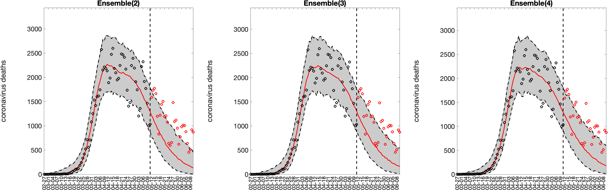

# SubEpiPredict

SubEpiPredict fits epidemic curves and produces short-term probabilistic forecasts in MATLAB. It models incidence as the sum of overlapping sub-epidemics. Candidate models can fit the same observed curve with different component trajectories. The toolbox ranks these models by the corrected Akaike information criterion (AICc), forecasts from each retained fit, and combines their forecasts in ensembles.

[Quick start](#quick-start) · [Use your own data](#use-your-own-data) · [Model settings](#model-settings) · [Forecast evaluation](#forecast-evaluation) · [Rolling origins](#rolling-origin-evaluation) · [Parameter identifiability](#parameter-identifiability) · [Output files](#output-files) · [Tutorial paper](https://doi.org/10.1016/j.idm.2024.02.001) · [Video tutorial](https://www.youtube.com/watch?v=lj_-2Kre1qw)

## Quick start

Fit daily U.S. COVID-19 deaths through May 11, 2020, then forecast May 12–15. Both the [fitting snapshot][fit-data] and the [later snapshot for scoring][eval-data] are included.

### 1. Open the code folder

Download and extract the repository or clone it from a terminal.

```bash
git clone https://github.com/gchowell/SubEpiPredict-Toolbox.git
```

In MATLAB, set **Current Folder** to the repository root and run the commands below. Keep the code folder current while running the toolbox. It reads `input/` and writes to `output/` relative to that folder.

```matlab
cd('ensemble n-subepidemic code v1.0')
if ~isfolder('output'), mkdir('output'); end
which options -all
```

The first result should be the toolbox's own `options.m`. Fitting uses Optimization Toolbox (`fmincon`), Global Optimization Toolbox (`MultiStart`), and Statistics and Machine Learning Toolbox. Parallel Computing Toolbox is optional. The shipped settings request a parallel pool and fall back to serial fitting if the pool cannot start. To select serial fitting directly, set `U.useParallel = false;` in [options_fit_settings.m][overrides]. The bundled figures were generated with MATLAB R2024a Update 6.

### 2. Fit and forecast

```matlab
areaColumn = 52;          % U.S. series in the bundled matrix
origin = '05-11-2020';    % Last day used for fitting
horizon = 4;              % Four daily observations beyond the origin
weightCode = -1;          % Equal ensemble weights

Run_Fit_subepidemicFramework(areaColumn, origin);
[ranked, ensembles, baseline, byHorizon] = ...
    plotForecast_subepidemicFramework(areaColumn, origin, horizon, weightCode);
```

Run the fit on the first pass. The repository's `output/` folder also contains examples from earlier configurations. Once the current ranked fits exist, you can repeat the forecast call with a different horizon or weighting scheme. [Fit driver][fit-driver] · [Forecast driver][forecast-driver]

### 3. Check the forecast

The ranked forecast CSV contains the calibration observations followed by the four forecasts. Its final four rows give the target dates, recorded deaths, predictive median, and 95% prediction limits.

```matlab
file = ['ranked(1)-onsetfixed-0-flag1-1-method-3-dist-3-horizon-4-' ...
        'daily-coronavirus-deaths-USA-area-52-05-11-2020.csv'];
forecast = readtable(fullfile('output', file));
targets = forecast(end-horizon+1:end, :);
disp(targets)
assert(isequal(targets.data, [1589; 1735; 1773; 1665]))
assert(abs(baseline(1) - 63.5) < 1e-8)
```

The baseline predicts **1,675.71 deaths per day**, the mean of the last seven fitting observations. Its mean absolute error (MAE) over all four targets is **63.5 deaths per day**. Both checks use the input data and are independent of the fitted parameters.

To compare the models at the same horizon, inspect their weighted interval scores (WIS). A relative WIS below 1 favors the model over the baseline.

```matlab
fourDay = byHorizon(byHorizon(:,2) == horizon, [1 3 6 7]);
disp(array2table(fourDay, 'VariableNames', ...
    {'ModelCode','MAE','WIS','RelativeWIS'}))
```

Code `0` is the baseline, `1` is the best AICc-ranked fit, and `102` is the ensemble of ranks 1 and 2. Ranking uses the calibration period. The scores above use the subsequent four days.


*All four models in the bundled figure have two components. Their onset thresholds differ, and the components peak at different times even where the total fits look similar. Run `plotFit_subepidemicFramework(areaColumn, origin)` to inspect these panels and write the parameter diagnostics.*

## Use your own data

1. **Prepare the series.** Place a header-free numeric text matrix in `input/`. Each row is one regularly spaced observation and each column is an area or group. Put calendar dates in the configuration. The loader reads the first column as data.
2. **Match the filename.** In [options.m][fit-options], set the data tags, `caddate1` (the last date in the fitting file, as `mm-dd-yyyy`), `datevecfirst1` (the date of row 1, as `[year month day]`), and `outbreakx` (the column to fit). The single-origin driver reads the chosen column through the **last row of the file**. To hold out later observations, end the fitting file at the intended origin.
3. **Set the time step and count type.** For daily, weekly, or annual observations, set `DT` to `1`, `7`, or `365` and use `daily`, `weekly`, or `yearly` in the filename. A horizon of 4 means four observations at that frequency.

| What each value measures | `cumulative1` | Filename in `input/` |
|---|---:|---|
| New events in the interval | `0` | `<frequency>-<caddisease>-<datatype>-<cadregion>-<caddate1>.txt` |
| Total events through the interval | `1` | `cumulative-<frequency>-<caddisease>-<datatype>-<cadregion>-<caddate1>.txt` |

For cumulative data, the fitter uses `[C(1); diff(C)]`. If the first total includes events that occurred before the series began, supply interval counts. Check for missing observations and negative revisions before using a count likelihood.

**Choose how the forecast will be used** in [options_forecast.m][forecast-options].

| Goal | `getperformance` | Required data and result |
|---|---:|---|
| Issue a forecast | `0` | Supply the fitting snapshot. The forecast CSV contains predictions, with `NaN` for future observations. Forecast-score arrays are empty. |
| Score a historical forecast | `1` | Also supply a later snapshot covering the full horizon, with the same first date and columns. Before fitting, set `datevecend1` in `options.m` to the date in that file's name. The toolbox exports predictions and scores. |

With these settings in place, call `Run_Fit_subepidemicFramework()` and then `plotForecast_subepidemicFramework()`. A vector of columns can be passed to the fit driver to fit each series independently. Forecast one column at a time. If you change the evaluation snapshot date after fitting, rerun the fit so the saved ranks carry the new date.

**Example using annual data.** The repository includes 21 annual COPD death counts for CHATHAM, 2000–2020. The matching settings use `DT = 365`, `outbreakx = 1`, and `cumulative1 = 0`. To try this example in a working copy, use the contents of `options_copd.m` as `options.m` and set `getperformance = 0` in `options_forecast.m` to forecast beyond 2020. The drivers read the active files named `options.m` and `options_forecast.m`. [COPD settings][copd-options] · [Annual data][copd-data]

**Calibration window.** The fitter uses up to the last `calibrationperiod1` rows, starting at the first positive count in that window. The default example requests 90 observations and uses all 75 available. A multi-component search needs at least 10 retained observations. A candidate with `k` parameters needs more than `k + 1` observations for a finite AICc.

## Model settings

Edit the assignments in these four files. The functions read them each time you run the corresponding analysis.

| File | What to set | Bundled example |
|---|---|---|
| [options.m][fit-options] | Data, calibration window, growth and observation models, search size, bootstrap refits | Generalized logistic growth, negative-binomial likelihood (`method1 = 3`, `dist1 = 3`), `numstartpoints = 20`, `B = 40` |
| [options_forecast.m][forecast-options] | Horizon, evaluation, ensemble weighting, retention of forecast MAT files | Four steps, `getperformance = 1`, equal weights, `deletetempfiles = 1` |
| [options_fit_settings.m][overrides] | Parallel fitting, seed, bounds, optimization and diagnostic thresholds | Parallel starts enabled. Other fields inherit the [built-in defaults][fit-settings], including `rngSeed = 1` |
| [options_Rt.m][rt-options] | Generation-interval distribution and history required to estimate the effective reproduction number | Gamma distribution, `minGIcoverage = 0.99` |

A **component** is one sub-epidemic within a fitted curve. An **ensemble member** is a complete fitted model. In the example, `npatches_fixed = 2` permits one or two components. Different onset thresholds can produce several two-component candidates, so `topmodelsx = 4` can retain four distinct models. `Ensemble(4)` pools the forecasts of the first four ranks when all four are available.

With `onset_fixed = 0`, a later component starts when its predecessor reaches a candidate cumulative count. With `onset_fixed = 1`, all components start together. The fitter ranks admissible configurations by increasing AICc. For rank *k*, the evidence ratio `exp((AICc_k − AICc_1)/2)` expresses relative support for rank 1 versus rank *k*. At the default warning threshold of 100, an equal-weight ensemble still gives that model the same weight as rank 1. The [rankings plotter][rank-driver] exports AICc and relative likelihood for each retained model. Attributing a fitted component to a location or transmission event requires independent evidence.

<details>
<summary>Growth equations, estimation methods, and optimization settings</summary>

`flag1` selects the growth equation for every component. Here `C` is its cumulative count, `r` its growth rate, `p` its growth-scaling exponent, `K` its carrying capacity, and `a` its shape parameter. [Growth equations][kernel]

| `flag1` | Model | Active component's `dC/dt` |
|---:|---|---|
| 0 | Generalized growth | `r C^p` |
| 1 | Generalized logistic | `r C^p (1 − C/K)` |
| 2 | Generalized Richards, outer-power form | `r C^p (1 − C/K)^a` |
| 3 | Logistic | `r C (1 − C/K)` |
| 4 | Richards | `r C (1 − (C/K)^a)` |
| 5 | Gompertz | `r C log(K/C)` |

`method1` selects the fitting objective. `dist1` selects the noise model used to generate bootstrap observations and future observations. Here `μ` is the fitted mean, `α` is dispersion, and `d` is a fitted variance exponent.

| `method1` | Objective | `dist1` and sampling model |
|---:|---|---|
| 0 | Unweighted least squares | `0` normal, `1` Poisson, or `2` negative binomial with variance `factor1 × μ` |
| 1 | Poisson likelihood | `1` Poisson |
| 3 | Negative-binomial likelihood | `3`, variance `μ + αμ` |
| 4 | Negative-binomial likelihood | `4`, variance `μ + αμ²` |
| 5 | Negative-binomial likelihood | `5`, variance `μ + αμ^d` |
| 6 | Least absolute deviations | `6` Laplace or `1` Poisson |

Select both `method1` and `dist1` explicitly for least squares (0) or least absolute deviations (6). For methods 1, 3, 4, and 5, `options.m` selects the matching `dist1`. These likelihoods use raw counts by default. The example's seven-point moving average helps define the candidate onset thresholds. For methods 0 and 6, `smoothfactor1` also controls the moving average used in the objective. Set the span to 1 to fit the original observations. [Fitting-series selection][fit-series]

`numstartpoints` controls the candidate search. The default uses an accepted solution from the preceding threshold as a starting point when available. A search without this starting point uses `firstThresholdStartFactor = 3` times the usual number of starts. `bootstrapStarts` controls additional starts for each bootstrap refit. [Annotated settings example][settings-example]

To plot a three-component generalized logistic curve with a specified onset threshold, run the example below from the code folder. [Simulation function][simulator]

```matlab
plot_nsubepidemic(1, [0.18 0.18 0.18], [0.98 0.98 0.98], [], ...
    [10000 5000 1000], 3, 100, 1, 220, 0);
```

</details>

## Forecast evaluation

Each usable bootstrap parameter vector generates a model trajectory and 20 simulated observation series. The forecast CSV reports the median and central 95% interval of the simulated observations. MAE and mean squared error (MSE) use the median of the model trajectories. To reproduce the toolbox's point-error scores, use the trajectory median. WIS and interval coverage use the predictive distribution. [Scoring functions][performance]

| Return from `plotForecast_subepidemicFramework` | Columns in order |
|---|---|
| `ranked` | Rank, MAE, MSE, 95% coverage (%), WIS, AICc, relative likelihood |
| `ensembles` | Ensemble size, MAE, MSE, 95% coverage (%), WIS |
| `baseline` | MAE, MSE, 95% coverage (%), WIS over the full horizon |
| `byHorizon` | Model code, horizon, MAE, MSE, 95% coverage (%), WIS, WIS relative to baseline |

A `byHorizon` row with horizon `h` scores **leads 1 through h together**. For example, the four-day baseline MAE of 63.5 averages four errors. Lower MAE, MSE, and WIS are better. Relative WIS divides the model's WIS by the baseline WIS at the same horizon. Interpret the ratio only for a finite, positive baseline WIS. Coverage is the percentage of targets inside the nominal 95% interval. With four targets, one observation changes coverage by 25 percentage points.

The daily baseline repeats the last seven observations' mean. The weekly and annual baselines repeat the last observation. Historical errors of the same rule supply lead-specific intervals. If history is too short for interval scores, the toolbox still reports baseline MAE and MSE. Set `U.baselineWindow` in `options_fit_settings.m` to change the averaging window. [Baseline calculation][baseline-code]

### Ensemble weights

`Ensemble(k)` pools sampled trajectories from ranks 1 through *k*. The number drawn from each member is rounded, so a low-weight member can contribute zero trajectories in a small sample.

| `weight_type1` | Weight used by the forecast driver |
|---:|---|
| `-1` | Equal weights (default) |
| `1` | Akaike weights proportional to `exp(−(AICc_k − AICc_min)/2)` |
| `2` | Inverse calibration WIS. Each calibration WIS must be finite and positive. |
| `0` | Legacy code that returns the same weights as `1` and issues a warning |
| `3` | The driver supplies calibration WIS to the earlier-forecast-score argument, giving the same weights as `2` in both single- and rolling-origin runs. |

[Forecast driver][forecast-driver] · [Weight calculations][weights]



*The bundled figure forecasts 30 days from May 11. The red line is the predictive median, the gray band is the 95% prediction interval, and the red circles are subsequent observations. The quick start scores the first four days of follow-up using a four-day forecast.*

### Rolling-origin evaluation

With the bundled U.S. settings and `getperformance = 1`, the following example evaluates three four-day forecasts. Each origin already has a fitting snapshot in `input/`. All three use the same later file for evaluation.

```matlab
origins = {'04-20-2020', '04-27-2020', '05-11-2020'};
R = subepidemicRollingForecast(origins, 4, 52, -1, 'quiet', true);
disp(table(R.dates(:), R.status(:,3), logical(R.status(:,5)), R.notes(:), ...
    'VariableNames', {'Origin','SnapshotCode','Scored','Note'}))
if ~isempty(R.summaryFile)
    disp(readtable(R.summaryFile, 'VariableNamingRule', 'preserve'))
end
```

- **Which data entered the fit?** For the selected column, snapshot code `2` means the existing file matches the later series through the origin, and `3` means it differs. Both use the existing file. Code `1` means the runner wrote a missing file by truncating the later snapshot. Such a file can include reporting revisions made after the origin. The three supplied snapshots above match the later series in column 52.
- **Which fits were reused?** The runner checks fit revision, settings and completeness. If observations are replaced under the same filename, or the evaluation date changes, pass `'refit', true`. By default the first replaced fit files are backed up in `output/replaced-by-rolling/`. With `'quiet', true`, per-origin logs are written to `output/`.
- **How should scores be compared?** `R.scoresFile` contains one row per scored origin, model and horizon. `R.summaryFile` reports mean WIS for leads 1 through *h* and for lead *h* alone. The ratio of mean WIS compares paired origins. The typical ratio is the geometric mean of positive paired ratios. A tie counts as half a win in the share of origins with better WIS. Use the `dates` column to see how many origins contributed to each model and horizon. Nearby origins can share targets. [Rolling forecast][rolling] · [Summary calculations][rolling-summary]

## Parameter identifiability

For each ranked model, the toolbox refits `B` synthetic datasets with its component count and onset threshold fixed. Its 95% bootstrap intervals describe practical identifiability conditional on that configuration. Structural identifiability requires a separate analysis.

Run the fit plotter to write one CSV per rank and a combined report. This example displays the estimated parameters for the best-ranked model in the quick start.

```matlab
plotFit_subepidemicFramework(areaColumn, origin);
file = ['PII-topRanked-onsetfixed-0-flag1-1-method-3-dist-3-' ...
        'daily-coronavirus-deaths-USA-area-52-05-11-2020.csv'];
D = readtable(fullfile('output', file));
disp(D(D.ranked_model == 1 & D.fixed == 0, ...
    {'parameter','estimate','CI_LB','CI_UB','PII_ratio','fracLB','fracUB'}))
```

| Columns | How to read them |
|---|---|
| `estimate`, `median`, `CI_LB`, `CI_UB` | Observed-data estimate, bootstrap median, and 2.5th and 97.5th bootstrap percentiles |
| `PII` | Parameter identifiability index, `log10(CI_UB / CI_LB)`. A value of 1 means a tenfold interval. A nonpositive lower limit gives `NaN`. |
| `PII_ratio`, `PII_scale`, `PII_box`, `PII_rangeFrac` | Fraction of the search width covered by the interval. On the log scale (`PII_scale = 1`), use `PII / PII_box`. On the linear scale (`0`), use `PII_rangeFrac`. The default warning starts at 0.50 for free parameters. |
| `fracLB`, `fracUB`, `bound_LB`, `bound_UB` | Fraction of refits near each search bound and the bounds themselves. The tolerance is 0.1% of the absolute bound value, so a zero bound requires an exact hit. |
| `MCSE_CI_LB`, `MCSE_CI_UB`, `MCSE_PII` | Monte Carlo standard errors of the two endpoints and PII due to the finite number of refits |
| `fixed` | `1` for a parameter held fixed during fitting |

For example, `PII_ratio = 0.60` means the interval spans 60% of the allowed width on the selected scale. Even with a narrow interval, a high `fracUB` means many estimates reached the upper bound. Interchangeable components are ordered by increasing growth rate `r`, with carrying capacity `K` breaking ties. [Diagnostic definitions][pii]

The bundled `B = 40` illustrates the workflow. For reported intervals, increase `B` and check whether endpoint estimates stabilize. The ranked MAT file's `bootstrapDiagnostics` records convergence, fallback use, and the number of active components per refit. An unresolved refit can still contribute its best valid endpoint.

## Output files

Look in the code folder's `output/`. In the patterns below, `k` is the rank of an individual fit or the number of models in an ensemble. Use the filename for your origin and settings. Some bundled examples use older filenames.

| What to find | Filename pattern | Created by |
|---|---|---|
| Candidate search and saved ranked fits | `ABC-ensem-*.mat`, `modifiedLogisticPatch-ensem-*-rank-k.mat` | Fit driver |
| AICc and relative likelihood for each rank | `AICc-topRanked-*.csv` | Rankings plotter |
| Parameter summaries and identifiability | `param-*-ranked(k)-*.csv`, `PII-ranked(k)-*.csv`, `PII-topRanked-*.csv` | Fit plotter |
| Observations, predictive median, 95% limits | `ranked(k)-*.csv`, `Ensemble(k)-*.csv` | Forecast plotter |
| 23 predictive quantiles from 0.01 through 0.99 | `quantile-ranked(k)-*.csv`, `quantileTimes-Ensemble(k)-*.csv` | Forecast plotter |
| Calibration and forecast scores | `performance-calibration-*.csv`, `performance-forecasting-*.csv`. The `byHorizon` forecast file includes the baseline | Fit and forecast plotters |
| Propagated trajectories and simulated observations | `Forecast-modifiedLogisticPatch-*.mat` (set `deletetempfiles = 0` to keep) | Forecast plotter |
| Performance across origins | `rolling-forecast-scores-*.csv`, `rolling-forecast-summary-*.csv` | Rolling forecast |
| Sequential doubling times and effective reproduction number | `doublingTimes-*.csv`, `Rt-ranked(k)-*.csv` | Fit or forecast plotter for doubling times, `plotReproductionNumber` for reproduction numbers |

The point-forecast and quantile CSVs contain calibration rows followed by forecast rows. Their last `horizon` rows are the forecasts. Align the quantile files with the corresponding point-forecast file by row. Daily and weekly point-forecast files include calendar dates. For annual data, the ranked file's `year` column is a sequential index. In particular, the first forecast row after a fit through 2020 represents 2021.

With `getperformance = 0`, the ranked point-forecast filename omits the horizon. Save a copy before forecasting the same series at another horizon. The ranked quantile filename includes the horizon in both modes.

<details>
<summary>Saved arrays and the effective reproduction number</summary>

| MAT-file variable | Contents |
|---|---|
| `Phatss` | One bootstrap parameter vector per refit |
| `curves` | Synthetic observations generated around the fitted curve |
| `curvesforecasts1` | Model trajectories propagated from bootstrap parameter estimates |
| `curvesforecasts2` | Simulated observations after adding observation noise |

To estimate the effective reproduction number, choose a gamma, exponential, or fixed generation interval in [options_Rt.m][rt-options], then run `plotReproductionNumber` after fitting. The script reads saved fits and clears the workspace and open figures on entry. Express the mean in observation steps and the variance in squared steps. For weekly data, divide a mean in days by 7 and a variance in days squared by 49. Early estimates are blank until the available history covers `minGIcoverage` of the generation-interval distribution.

</details>

## Regenerating the figures

The six reference figures use fit revision `m1`, seed `1`, four ranked models, and a 30-day forecast. The four-day quick start uses the same fit. To export the six panels from that fit, run these commands in order. Each plotter closes the previous figures. [Figure settings](docs/images/README_figures_info.txt)

```matlab
plotFit_subepidemicFramework(areaColumn, origin);
print(figure(301 + size(ranked,1)), fullfile('output','model_fit.png'), '-dpng');
print(figure(301), fullfile('output','parameters.png'), '-dpng');

plotRankings_subepidemicFramework(areaColumn, origin);
print(figure(99), fullfile('output','rankings.png'), '-dpng');
print(figure(100), fullfile('output','ranking_profiles.png'), '-dpng');

plotForecast_subepidemicFramework(areaColumn, origin, 30, weightCode);
print(figure(10), fullfile('output','ranked_forecasts.png'), '-dpng');
print(figure(500), fullfile('output','ensembles.png'), '-dpng');
```

[Model rankings](docs/images/rankings.png) · [Component profiles](docs/images/ranking_profiles.png) · [Parameter distributions](docs/images/parameters.png) · [Ranked forecasts](docs/images/ranked_forecasts.png)

## Reproducibility and troubleshooting

For a reproducible run, keep the input snapshots and options files with the outputs. Record the Git commit, MATLAB and toolbox versions, seed, `B`, horizon, and weighting scheme. The ranked MAT file stores the fit revision and settings in `fitSignature`. The default seed (`1`) resets the generator at the start of each area's fit and when plotting fits, forecasting, or estimating the reproduction number. Set `U.rngSeed = [];` to manage the stream yourself. [Fit settings][overrides]

The fit and forecast plotters write to the same ranked calibration-score CSV. To retain a calibration table with AICc and relative likelihood, save the fit plotter's output or use the separate `AICc-topRanked-*.csv` from the rankings plotter.

| Symptom | What to check |
|---|---|
| MATLAB cannot find an input file or a saved rank | Check the current folder, snapshot date, column, and `cumulative-` prefix. Fit the same series and settings before plotting |
| The fitter skips a series or retains fewer ranks than requested | Check the retained observations and the candidate diagnostics for inactive components or insufficient data for AICc |
| An older fit warns that its parameter bounds were rebuilt | The identifiability report uses the current bounds when the saved fit lacks them. Rerun the fit with the intended bounds before interpreting bound-relative diagnostics. |
| Ranks change with the seed | Increase `numstartpoints` and compare AICc differences across fits. Increase `B` when the bootstrap interval endpoints vary |
| A rolling origin was skipped or refitted | Read `R.notes` and the per-origin log (`'quiet', true`). Check snapshot dimensions, available follow-up, and fit signature |
| Forecast propagation skips refits | Inspect the warnings for the affected rank. The default stops when more than 5% of its refits cannot be propagated |

## Citation

Chowell G, Dahal S, Bleichrodt A, Tariq A, Hyman JM, Luo R. **SubEpiPredict: A tutorial-based primer and toolbox for fitting and forecasting growth trajectories using the ensemble n-sub-epidemic modeling framework.** *Infectious Disease Modelling*. 2024;9(2):411–436. [Tutorial paper](https://doi.org/10.1016/j.idm.2024.02.001)

For the underlying ensemble framework, see Chowell et al. (2022), *An ensemble n-sub-epidemic modeling framework for short-term forecasting epidemic trajectories: Application to the COVID-19 pandemic in the USA*. [PLOS Computational Biology](https://doi.org/10.1371/journal.pcbi.1010602)

<details>
<summary>BibTeX</summary>

```bibtex
@article{Chowell2024SubEpiPredict,
  author  = {Chowell, Gerardo and Dahal, Sushma and Bleichrodt, Amanda
             and Tariq, Amna and Hyman, James M. and Luo, Ruiyan},
  title   = {{SubEpiPredict}: A tutorial-based primer and toolbox for fitting
             and forecasting growth trajectories using the ensemble
             n-sub-epidemic modeling framework},
  journal = {Infectious Disease Modelling},
  year    = {2024},
  volume  = {9},
  number  = {2},
  pages   = {411--436},
  doi     = {10.1016/j.idm.2024.02.001}
}
```

</details>

## License and contact

SubEpiPredict is distributed under the [GNU General Public License v3.0](LICENSE). For software questions or reproducible bug reports, contact Gerardo Chowell through the [GitHub issue tracker](https://github.com/gchowell/SubEpiPredict-Toolbox/issues).

[fit-data]: ensemble%20n-subepidemic%20code%20v1.0/input/cumulative-daily-coronavirus-deaths-USA-05-11-2020.txt
[eval-data]: ensemble%20n-subepidemic%20code%20v1.0/input/cumulative-daily-coronavirus-deaths-USA-05-09-2022.txt
[fit-options]: ensemble%20n-subepidemic%20code%20v1.0/options.m
[forecast-options]: ensemble%20n-subepidemic%20code%20v1.0/options_forecast.m
[overrides]: ensemble%20n-subepidemic%20code%20v1.0/options_fit_settings.m
[fit-settings]: ensemble%20n-subepidemic%20code%20v1.0/subepidemicFitSettings.m
[settings-example]: ensemble%20n-subepidemic%20code%20v1.0/options_fit_settings_example.m
[fit-series]: ensemble%20n-subepidemic%20code%20v1.0/subepidemicFitSeries.m
[rt-options]: ensemble%20n-subepidemic%20code%20v1.0/options_Rt.m
[kernel]: ensemble%20n-subepidemic%20code%20v1.0/modifiedLogisticGrowthPatch.m
[simulator]: ensemble%20n-subepidemic%20code%20v1.0/simulateSubepidemic.m
[pii]: ensemble%20n-subepidemic%20code%20v1.0/subepidemicIdentifiability.m
[weights]: ensemble%20n-subepidemic%20code%20v1.0/subepidemicEnsembleWeights.m
[forecast-driver]: ensemble%20n-subepidemic%20code%20v1.0/plotForecast_subepidemicFramework.m
[performance]: ensemble%20n-subepidemic%20code%20v1.0/computeforecastperformance.m
[rolling]: ensemble%20n-subepidemic%20code%20v1.0/subepidemicRollingForecast.m
[rolling-summary]: ensemble%20n-subepidemic%20code%20v1.0/subepidemicRollingSummary.m
[fit-driver]: ensemble%20n-subepidemic%20code%20v1.0/Run_Fit_subepidemicFramework.m
[rank-driver]: ensemble%20n-subepidemic%20code%20v1.0/plotRankings_subepidemicFramework.m
[baseline-code]: ensemble%20n-subepidemic%20code%20v1.0/subepidemicBaselineForecast.m
[copd-options]: ensemble%20n-subepidemic%20code%20v1.0/options_copd.m
[copd-data]: ensemble%20n-subepidemic%20code%20v1.0/input/yearly-copd-deaths-CHATHAM-12-31-2020.txt
