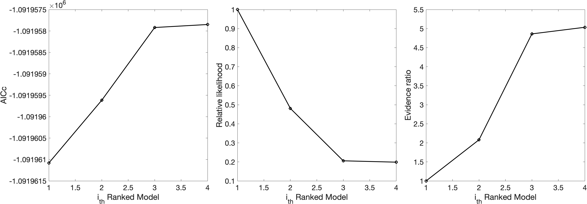
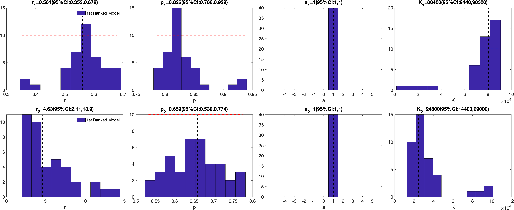

# SubEpiPredict

SubEpiPredict is a MATLAB toolbox for fitting epidemic curves and making short-term probabilistic forecasts. It represents incidence as the sum of one or more overlapping sub-epidemics, ranks candidate models by the corrected Akaike information criterion (AICc), and refits the highest-ranked models to bootstrap samples. Users can forecast with each model or an ensemble, examine how precisely its parameters are estimated, and evaluate forecasts against a flat baseline at successive forecast dates.

[Quick start](#quick-start) · [Use your own data](#use-your-own-data) · [Model settings](#model-settings) · [Parameter identifiability](#parameter-identifiability) · [Forecast evaluation](#forecast-evaluation) · [Rolling-origin evaluation](#rolling-origin-evaluation) · [Output files](#output-files) · [Regenerating the figures](#regenerating-the-figures) · [Tutorial paper](https://doi.org/10.1016/j.idm.2024.02.001) · [Video tutorial](https://www.youtube.com/watch?v=lj_-2Kre1qw)

## Quick start

Fit the bundled daily U.S. COVID-19 death series through **May 11, 2020**, then forecast **May 12–15**. Both the fitting data and the later observations used for scoring are included. The example uses the settings shipped with the toolbox.

### 1. Open the toolbox in MATLAB

Install MATLAB with **Optimization Toolbox** (`fmincon`), **Global Optimization Toolbox** (`MultiStart`), and **Statistics and Machine Learning Toolbox** (random variates and sampling). Parallel Computing Toolbox is optional. The supplied [options_fit_settings.m][overrides] enables parallel starts. To run serially, set `U.useParallel = false;` in that file. If the pool cannot start, the fitter falls back to serial execution.

Download the repository ZIP from GitHub or clone it in a terminal.

```bash
git clone https://github.com/gchowell/SubEpiPredict-Toolbox.git
```

Set MATLAB's **Current Folder** to the repository root and run the following. The fit and forecast routines resolve `input/` and `output/` relative to the current folder.

```matlab
codeDir = fullfile(pwd, 'ensemble n-subepidemic code v1.0');
cd(codeDir)
addpath(codeDir)
if ~isfolder('output'), mkdir('output'); end
which options -all
```

The first `options.m` listed should be the one in `codeDir`.

### 2. Fit the example and score the forecast

```matlab
areaColumn = 52;
origin = '05-11-2020';
horizon = 4;
weightCode = -1;   % Equal ensemble weights

Run_Fit_subepidemicFramework(areaColumn, origin);
[ranked, ensembles, baseline, byHorizon] = ...
    plotForecast_subepidemicFramework(areaColumn, origin, horizon, weightCode);

% Compare all models over the four forecast days.
fourDay = byHorizon(byHorizon(:,2) == horizon, [1 3 6 7]);
disp(array2table(fourDay, ...
    'VariableNames', {'ModelCode','MAE','WIS','RelativeWIS'}))
```

Model code `0` is the baseline, `1` is the best-ranked fitted model, and `102` is an ensemble of ranks 1 and 2. A relative weighted interval score (WIS) below 1 favors the model over the baseline. The saved fit can be reused to change the horizon or ensemble weights.

**Check the example against the data.** In the ranked forecast CSV, the last four entries in the `data` column should be **1,589, 1,735, 1,773, and 1,665**. The seven-day flat baseline predicts **1,675.71** deaths each day, giving a four-day mean absolute error (MAE) of **63.5**. These checks depend only on the two input files. [Fitting snapshot][fit-data] · [Evaluation snapshot][eval-data]

### 3. Inspect the fit

Run these calls separately to inspect each figure before opening the next one.

```matlab
plotFit_subepidemicFramework(areaColumn, origin);
plotRankings_subepidemicFramework(areaColumn, origin);
```

The fit plotter writes parameter estimates and practical identifiability diagnostics to `output/`. Start with `PII-topRanked-*.csv` to compare parameters across models. For the forecasts, use `ranked(1)-*.csv` for the best model's daily median and 95% prediction limits, and `performance-forecasting-byHorizon-*.csv` for the baseline comparison.


*The four retained models of the quick-start example. The figures in this README are drawn by the toolbox's own plotting functions; see [Regenerating the figures](#regenerating-the-figures).*

## Use your own data

1. Put a numeric, header-free text file in `input/`. Use one row per regularly spaced observation and one column per area or group. Put dates in the configuration. The loader treats **every column as a data series**, including column 1.
2. In [options.m][fit-options], set `outbreakx` to the series column, `DT` to the reporting interval (1 = daily, 7 = weekly, 365 = yearly), and `datevecfirst1` to the date of row 1. Set the disease, outcome, region, and snapshot date to match the filename below.
3. Fit a snapshot ending at the forecast origin. For retrospective scoring, set `datevecend1` to the date of a later snapshot with the same start date, frequency, and columns. For a forecast without later observations, set `getperformance = 0` in [options_forecast.m][forecast-options].

| Input | `cumulative1` | Filename under `input/` |
|---|---:|---|
| Counts per observation interval | `0` | `<daily/weekly/yearly>-<disease>-<datatype>-<region>-<mm-dd-yyyy>.txt` |
| Cumulative counts | `1` | Same filename with the prefix `cumulative-` |

For example, `weekly-influenza-cases-ExampleRegion-03-31-2024.txt` uses `DT = 7`, `cumulative1 = 0`, `caddisease = 'influenza'`, `datatype = 'cases'`, `cadregion = 'ExampleRegion'`, and `caddate1 = '03-31-2024'`. A one-column file uses `outbreakx = 1`. The fit driver can also fit several columns independently, for example `Run_Fit_subepidemicFramework([3 7 52], '05-11-2020')` for the bundled file.

**Cumulative data.** The loader uses `[C(1); diff(C)]` as incidence. If the series starts midway through an outbreak, supply interval counts when the first cumulative total includes earlier events. Check for missing values and negative increments from reporting corrections before fitting a count likelihood.

**Calibration and horizon.** The fit uses up to the last `calibrationperiod1` rows, starting at the first positive count within that window. The example requests 90 observations and uses all 75 available. With multiple components requested, the driver skips a series with fewer than 10 retained observations. Each candidate also needs more observations than its parameter count plus one for AICc. Model time advances one unit per observation, so a four-step horizon on weekly data forecasts four weeks.

## Model settings

Edit assignments **inside the options files**. The entry points reload these functions each time they run.

| File | What it controls | Shipped example |
|---|---|---|
| [options.m][fit-options] | Dataset, calibration window, estimator, growth model, candidate search, bootstrap size | Column 52, 90 observations requested, smoothing span 7, negative binomial (`method1 = 3`, `dist1 = 3`), 20 search starts, `B = 40` |
| [options_forecast.m][forecast-options] | Horizon, scoring, ensemble weights, intermediate files | Four steps, `getperformance = 1`, equal weights (`-1`), `deletetempfiles = 1` |
| [options_fit_settings.m][overrides] | Overrides for parallel use, seed, bounds, optimizer, and diagnostics | Enables parallel starts. Other settings inherit the [built-in defaults][fit-settings], including `rngSeed = 1` |
| [options_Rt.m][rt-options] | Generation-interval distribution and coverage required for estimating the effective reproduction number | Gamma distribution and `minGIcoverage = 0.99` |

### Components and model ranking

A **component** is one sub-epidemic within a fitted curve. An **ensemble member** is a complete fitted curve. In the example, `npatches_fixed = 2` searches models with one or two components, and `topmodelsx = 4` retains up to four configurations. Two configurations with the same component count can have different onset thresholds. `Ensemble(4)` pools the forecasts of the first four ranked configurations when all four are available.

With `onset_fixed = 0`, a later component starts when its predecessor reaches a candidate cumulative threshold. With `onset_fixed = 1`, all components start together. The search excludes configurations with inactive components or insufficient data for AICc and ranks the remaining fits from lowest AICc upward. The reported evidence ratio, `exp((AICc_k − AICc_1)/2)`, measures relative support for rank 1 versus rank *k* within this candidate set. At a ratio of 100 or greater, the default settings flag the weaker model and retain it. A component represents a growth pattern. Assigning a biological or geographic cause requires independent evidence.

<details>
<summary>Growth equations, observation models, and search settings</summary>

One value of `flag1` applies to all components. In the equations below, `C` is a component's cumulative count, `r` its growth rate, `p` its growth-scaling exponent, `K` its carrying capacity, and `a` its shape parameter. [Growth equations in the source][kernel]

| `flag1` | Model | Active component's `dC/dt` |
|---:|---|---|
| 0 | Generalized growth | `r C^p` |
| 1 | Generalized logistic (shipped example) | `r C^p (1 − C/K)` |
| 2 | Generalized Richards, outer-power form | `r C^p (1 − C/K)^a` |
| 3 | Logistic | `r C (1 − C/K)` |
| 4 | Richards | `r C (1 − (C/K)^a)` |
| 5 | Gompertz | `r C log(K/C)` |

`method1` chooses the fitting objective. `dist1` controls noise in the bootstrap observations and predictive simulations. Here `μ` is the fitted mean, `α` is dispersion, and `d` is a fitted variance exponent in method 5.

| `method1` | Objective | Valid `dist1` and sampling model |
|---:|---|---|
| 0 | Unweighted least squares | `0` normal, `1` Poisson, or `2` negative binomial with variance `factor1 × μ` |
| 1 | Poisson likelihood | `1` Poisson |
| 3 | Negative-binomial likelihood | `3`, variance `μ + αμ` |
| 4 | Negative-binomial likelihood | `4`, variance `μ + αμ²` |
| 5 | Negative-binomial likelihood | `5`, variance `μ + αμ^d` |
| 6 | Least absolute deviations | `6` Laplace or `1` Poisson |

For methods 1, 3, 4, and 5, `options.m` sets the matching `dist1` automatically. These methods fit the raw counts by default. Smoothing still shapes the onset-threshold grid. For least squares and least absolute deviations, `smoothfactor1` controls the moving average fitted by the objective. A span of 1 uses the original observations. [Fitting-series selection][fit-series]

`numstartpoints` controls the candidate search. By default the search adds the accepted fit from the preceding threshold as a starting point when available. A search without that starting point uses `firstThresholdStartFactor = 3` times the usual number of starts. `bootstrapStarts` separately controls additional starts for each bootstrap refit. Set overrides such as `U.rUB` or `U.KUB` in [options_fit_settings.m][overrides]. [Annotated settings example][settings-example]

To simulate a three-component generalized logistic curve without fitting data, use the following call. The final argument selects threshold-triggered onset.

```matlab
plot_nsubepidemic(1, [0.18 0.18 0.18], [0.98 0.98 0.98], [], ...
    [10000 5000 1000], 3, 100, 1, 220, 0);
```

For programmatic simulation across all six growth models, use [simulateSubepidemic.m][simulator].

</details>

## Parameter identifiability

For each retained model, the toolbox generates `B` synthetic datasets and refits the parameters while holding the component count and onset threshold fixed. The resulting intervals describe uncertainty **conditional on that configuration**. Look at the diagnostic for each parameter alongside its fitted value, and compare configurations with similar AICc.

The fit prints the parameter identifiability index (PII) and its companion diagnostics. `plotFit_subepidemicFramework` writes `PII-ranked(k)-*.csv` for each rank and `PII-topRanked-*.csv` for comparison across ranks. These are the column names in the CSVs.

| Column | How to read it |
|---|---|
| `estimate`, `median`, `CI_LB`, `CI_UB` | Estimate from the observed data, bootstrap median, and 2.5th and 97.5th bootstrap percentiles |
| `PII` | `log10(CI_UB / CI_LB)`. A value of 1 means a tenfold interval. A nonpositive lower limit gives `NaN` |
| `PII_rangeFrac`, `PII_box`, `PII_scale` | Interval width divided by the search width, log width of positive search bounds, and the selected scale (1 = log, 0 = linear range fraction) |
| `PII_ratio` | Fraction of the available width on the selected scale. It equals `PII / PII_box` on the log scale and `PII_rangeFrac` on the linear scale |
| `fracLB`, `fracUB`, `bound_LB`, `bound_UB` | Fractions of refits near each search bound, alongside the bounds used. The default tolerance is 0.1% of the absolute bound value |
| `MCSE_PII`, `MCSE_CI_LB`, `MCSE_CI_UB` | Monte Carlo standard errors for the reported PII and interval limits |
| `fixed` | A value of 1 identifies a parameter held fixed during fitting |

For example, `PII_ratio = 0.60` means the interval occupies 60% of the allowed width on the selected scale. The default `NotIdentified` warning begins at 0.50 for a free parameter. This flags limited **practical** precision under the specified data, model, and bounds. Structural identifiability requires a separate analysis. A large `fracUB` can also flag a bound-sensitive estimate even when the ratio is small. Interchangeable components are ordered by increasing `r`, with ties broken by `K`, so their summaries reflect that ordering. [Diagnostic definitions][pii]

The example's 40 refits are enough to illustrate the workflow. For reported intervals, check the Monte Carlo errors and increase `B` until the interval endpoints are sufficiently stable for the analysis. The fit summary also reports unresolved refits and inactive bootstrap components. An unresolved optimization can contribute its best valid endpoint to the bootstrap sample.

## Forecast evaluation

The forecast routine propagates the bootstrap parameter estimates, then generates 20 observation-noise realizations for each successfully propagated trajectory. Prediction intervals for **future observations** include both sources of variation. `Ensemble(k)` samples trajectories from the first *k* ranked models using the selected weights. Rounding the number sampled per member can omit a low-weight model in a small sample.

| `weight_type1` | Ensemble weights |
|---:|---|
| `-1` | Equal weights (shipped setting) |
| `1` | Akaike weights proportional to `exp(−(AICc_k − AICc_min)/2)` |
| `0` | Compatibility code for the same Akaike weights, with a warning. Older versions used reciprocal AICc for this code |
| `2` | Weights proportional to the reciprocal of calibration WIS. Scores must be finite and positive |

An internal code `3` also exists. It weights each member by the reciprocal of the WIS of the **same forecast that is being scored**, computed against the later observations. Its ensemble scores therefore use hindsight and are not forecast performance; with `getperformance = 0` it has no scores and stops. Each rolling origin calls the same driver, so code 3 supplies no independent history of forecast performance either. [Forecast driver][forecast-driver] · [Weight calculations][weights]

With `getperformance = 1` and a positive horizon, the four return values are **numeric arrays**. The corresponding CSV files have headers. With `getperformance = 0`, the routine still exports forecasts, leaves future observations as `NaN`, and returns empty score arrays.

| Return value in the example | Columns, in order |
|---|---|
| `ranked` | Rank, MAE, mean squared error (MSE), 95% prediction interval coverage (%), WIS, AICc, relative likelihood |
| `ensembles` | Ensemble size, MAE, MSE, 95% coverage (%), WIS |
| `baseline` | MAE, MSE, 95% coverage (%), WIS at the full requested horizon |
| `byHorizon` | Model code, horizon, MAE, MSE, 95% coverage (%), WIS, WIS divided by baseline WIS (interpretable when baseline WIS is finite and positive) |

A horizon of 4 in this table summarizes **leads 1 through 4**. The baseline holds the mean of the last seven observations constant for daily data and the last observation constant for weekly or annual data. Past errors of this rule provide lead-specific baseline intervals. When the calibration history is too short to construct intervals, the baseline still has MAE and MSE. Lower MAE, MSE, and WIS indicate better performance. Interpret coverage against the nominal 95% and report how many forecast targets contributed.

For ranked models and ensembles, MAE and MSE use the median of the propagated model trajectories. The `median` in a forecast CSV comes from the simulations with observation noise. Those two medians can differ. [Scoring functions][performance]


*`Ensemble(2)` to `Ensemble(4)` of the example. The shaded bands are prediction intervals for observations, conditional on the retained configurations.*

## Rolling-origin evaluation

Use several origins to see how forecast performance varies over time and by lead. Keep `getperformance = 1` and supply a later snapshot covering the full horizon after each origin. This small example reuses the settings and series from the quick start.

```matlab
origins = {'05-11-2020', '05-25-2020', '06-08-2020'};
R = subepidemicRollingForecast(origins, 4, 52, -1, 'quiet', true);
disp(R.statusColumns)
disp(R.status)
if ~isempty(R.summaryFile), disp(readtable(R.summaryFile)); end
```

- **Data available at an origin.** The routine uses a correctly sized, existing input snapshot for that date. If it is missing, it writes one by truncating the later snapshot. The reconstructed series includes retrospective corrections. Supply archived snapshots when evaluating what could have been forecast in real time.
- **Resuming a run.** Compatible, complete saved fits are reused. The check includes the fit revision, fit settings, `B`, search starts, and requested ranks. If you change the contents of an input file under the same name, pass `'refit', true` to fit again. By default the first replaced copy of each fit file is kept in `output/replaced-by-rolling/`.
- **Results.** `R.status` and `R.notes` identify reused, skipped, or failed dates. `R.scoresFile` contains one row per scored origin, model, and horizon. `R.summaryFile` contains scores averaged across origins, including WIS and coverage for **lead h alone** as well as leads **1 through h**. With `'quiet', true`, per-origin logs are written to `output/`.
- **Comparison with the baseline.** The ratio of mean WIS compares total forecast error across paired origins. The typical ratio is the geometric mean of positive paired ratios. The share of origins won counts ties as half. Check the number of scored origins for each rank. Overlapping target periods share observations, and daily forecasts issued on the same weekday can show a weekday effect at individual leads.

[Rolling forecast options and return fields][rolling] · [Summary calculations][rolling-summary]

## Output files

All paths below are relative to the code folder's `output/`. Here `k` stands for the fitted rank or ensemble size.

| To find | Open | Written by |
|---|---|---|
| Search results and diagnostics | `ABC-ensem-*.mat` | Fit driver |
| Observed-data fit and bootstrap refits | `modifiedLogisticPatch-ensem-*-rank-k.mat` | Fit driver |
| Per-parameter estimates and identifiability | `param-*-ranked(k)-*.csv`, `PII-ranked(k)-*.csv`, `PII-topRanked-*.csv` | Fit plotter |
| Dated observations, predictive median, 95% limits | `ranked(k)-*.csv`, `Ensemble(k)-*.csv` | Forecast plotter |
| 23 predictive quantiles, from 0.01 to 0.99 | `quantile-ranked(k)-*.csv`, `quantileTimes-Ensemble(k)-*.csv` | Forecast plotter |
| Scores in calibration or forecasting | `performance-calibration-*.csv`, `performance-forecasting-*.csv`. The `byHorizon` forecast file includes the baseline | Fit and forecast plotters |
| Propagated curves and noisy simulations | `Forecast-modifiedLogisticPatch-*.mat`. Set `deletetempfiles = 0` to keep these files | Forecast plotter |
| Scores across dates | `rolling-forecast-scores-*.csv`, `rolling-forecast-summary-*.csv` | Rolling forecast |
| Doubling-time and reproduction-number summaries | `doublingTimes-*.csv`, `Rt-ranked(k)-*.csv` | Fit or forecast plotters for doubling times, `plotReproductionNumber` for reproduction numbers |

Forecast CSVs combine calibration and forecast rows. The last `horizon` rows are the forecasts. Align the quantile files to the corresponding point-forecast file by row. Daily and weekly point-forecast files include calendar fields. The annual ranked export uses an observation index in the column labeled `year`.

<details>
<summary>Saved arrays, reproduction numbers, and additional figures</summary>

| MAT-file variable | Interpretation |
|---|---|
| `Phatss` | One bootstrap parameter vector per refit |
| `curves` | Synthetic observations generated around the fitted curve |
| `curvesforecasts1` | Model trajectories propagated from bootstrap parameter estimates |
| `curvesforecasts2` | Simulated observations after adding observation noise |

To estimate the effective reproduction number, set the generation-interval assumptions in [options_Rt.m][rt-options], then run `plotReproductionNumber` after fitting. The script reads saved fits and begins by clearing the workspace and closing figures. It supports gamma, exponential, and fixed generation intervals. Specify the mean in observation steps and the variance in squared steps (for weekly data, divide a day-scale mean by 7 and a day-squared variance by 49). Early estimates are blank until the available history covers the configured fraction of the generation-interval distribution.





</details>

## Regenerating the figures

[make_readme_figures.m][figures] redraws the images of this README with the current source. Run it from the code folder:

```matlab
files = make_readme_figures();                 % 30-step horizon, settings of the options files
files = make_readme_figures('horizon', 4);     % the four-day horizon of the quick start
```

It reuses a saved fit of the example when one exists, calls the fit plotter, the ranking plotter, and the forecast plotter, and writes `model_fit.png`, `parameters.png`, `rankings.png`, `ensembles.png`, `ranking_profiles.png`, and `ranked_forecasts.png` to `docs/images/`. `README_figures_info.txt` in the same folder records the settings, seed, fit revision, and date. It requires MATLAB R2020a or later.

## Reproducibility and troubleshooting

The example uses fit revision `m1` from the [November 18, 2026 source](https://github.com/gchowell/SubEpiPredict-Toolbox/tree/52638c39af57b5d2e681c00567cb9ac43fe996d5). For your own analysis, record the Git commit, MATLAB and toolbox versions, input snapshots, options files, seed, `B`, and forecast settings. The fit driver, fit plotter, forecast plotter, and reproduction-number script apply `rngSeed` on entry (once per area for fitting). To control the random stream yourself, set `U.rngSeed = [];` in [options_fit_settings.m][overrides]. Ranked-fit MAT files contain `fitSignature`. Archive each run's output before changing settings because several outputs share filenames, including the ranked calibration-score CSV written by both plotters.

| Symptom | What to check |
|---|---|
| An input file or saved rank cannot be found | Check the current folder, date tag, column, and incidence/cumulative prefix. Run the fit before plotting with the same dataset and fit settings |
| Fitting skips a series or drops candidates | Check for a positive count and count the observations left after trimming. Reduce the requested complexity or use a longer calibration window |
| Fewer models are retained than requested | Check the search diagnostics for inactive or inadmissible configurations. Inspect the ranks actually saved |
| Ranks change with the random seed | Increase `numstartpoints` and compare AICc differences across fits. Increase `B` separately when bootstrap interval endpoints are unstable |
| A rolling origin was skipped or refitted | Inspect `R.status`, `R.notes`, the dated input file, available follow-up, and the fit signature |
| A parameter is flagged or a forecast uses fewer refits | Check the PII ratio, bound-hit fractions, and bootstrap diagnostics. Forecast propagation warns about skipped refits and stops above the default skipped fraction of 0.05 |

## Citation

Chowell G, Dahal S, Bleichrodt A, Tariq A, Hyman JM, Luo R. **SubEpiPredict: A tutorial-based primer and toolbox for fitting and forecasting growth trajectories using the ensemble n-sub-epidemic modeling framework.** *Infectious Disease Modelling*. 2024;9(2):411–436. [Tutorial paper](https://doi.org/10.1016/j.idm.2024.02.001)

For the underlying ensemble framework, see Chowell et al. (2022), *An ensemble n-sub-epidemic modeling framework for short-term forecasting epidemic trajectories: Application to the COVID-19 pandemic in the USA*. [PLOS Computational Biology](https://doi.org/10.1371/journal.pcbi.1010602)

<details>
<summary>BibTeX</summary>

```bibtex
@article{Chowell2024SubEpiPredict,
  author  = {Chowell, Gerardo and Dahal, Sushma and Bleichrodt, Amanda
             and Tariq, Amna and Hyman, James M. and Luo, Ruiyan},
  title   = {{SubEpiPredict}: A tutorial-based primer and toolbox for fitting
             and forecasting growth trajectories using the ensemble
             n-sub-epidemic modeling framework},
  journal = {Infectious Disease Modelling},
  year    = {2024},
  volume  = {9},
  number  = {2},
  pages   = {411--436},
  doi     = {10.1016/j.idm.2024.02.001}
}
```

</details>

## License and contact

SubEpiPredict is distributed under the [GNU General Public License v3.0](LICENSE). For software questions or reproducible bug reports, contact Gerardo Chowell through the [GitHub issue tracker](https://github.com/gchowell/SubEpiPredict-Toolbox/issues).

[fit-data]: ensemble%20n-subepidemic%20code%20v1.0/input/cumulative-daily-coronavirus-deaths-USA-05-11-2020.txt
[eval-data]: ensemble%20n-subepidemic%20code%20v1.0/input/cumulative-daily-coronavirus-deaths-USA-05-09-2022.txt
[fit-options]: ensemble%20n-subepidemic%20code%20v1.0/options.m
[forecast-options]: ensemble%20n-subepidemic%20code%20v1.0/options_forecast.m
[overrides]: ensemble%20n-subepidemic%20code%20v1.0/options_fit_settings.m
[fit-settings]: ensemble%20n-subepidemic%20code%20v1.0/subepidemicFitSettings.m
[settings-example]: ensemble%20n-subepidemic%20code%20v1.0/options_fit_settings_example.m
[fit-series]: ensemble%20n-subepidemic%20code%20v1.0/subepidemicFitSeries.m
[rt-options]: ensemble%20n-subepidemic%20code%20v1.0/options_Rt.m
[kernel]: ensemble%20n-subepidemic%20code%20v1.0/modifiedLogisticGrowthPatch.m
[simulator]: ensemble%20n-subepidemic%20code%20v1.0/simulateSubepidemic.m
[pii]: ensemble%20n-subepidemic%20code%20v1.0/subepidemicIdentifiability.m
[weights]: ensemble%20n-subepidemic%20code%20v1.0/subepidemicEnsembleWeights.m
[forecast-driver]: ensemble%20n-subepidemic%20code%20v1.0/plotForecast_subepidemicFramework.m
[performance]: ensemble%20n-subepidemic%20code%20v1.0/computeforecastperformance.m
[rolling]: ensemble%20n-subepidemic%20code%20v1.0/subepidemicRollingForecast.m
[rolling-summary]: ensemble%20n-subepidemic%20code%20v1.0/subepidemicRollingSummary.m
[figures]: ensemble%20n-subepidemic%20code%20v1.0/make_readme_figures.m
