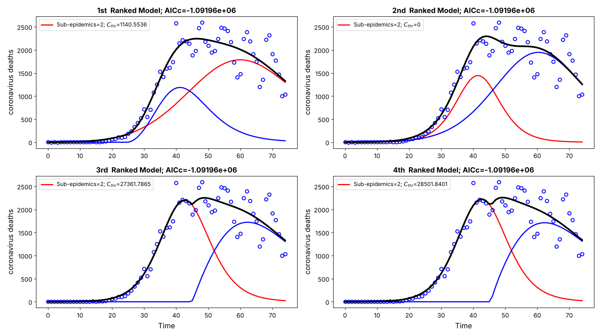
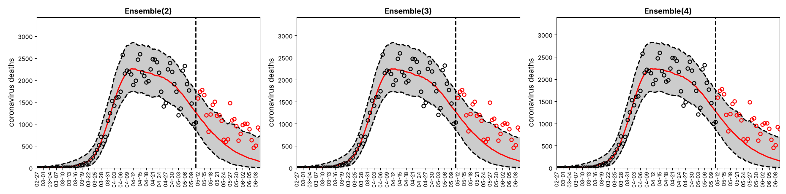

# SubEpiPredict for Python

A Python port of the SubEpiPredict MATLAB toolbox: fit ensemble n-sub-epidemic models to an incidence series, rank them by AICc, and forecast the next observations with the top-ranked models and their ensembles, with a parametric bootstrap for the uncertainty.

Functions keep their MATLAB names and argument order, and the output files keep their MATLAB names and layouts, so the [main README](../README.md) describes this port as well. This page covers what is specific to Python.

[Quick start](#quick-start) · [MATLAB to Python](#matlab-to-python) · [Options and settings](#options-and-settings) · [Differences from MATLAB](#differences-from-matlab) · [Tests and validation](#tests-and-validation)

## Installation

Python 3.9 or later with NumPy (1.22 or later), SciPy and Matplotlib. No MATLAB toolbox is needed. The port was written and tested with Python 3.13, NumPy 2.5, SciPy 1.18 and Matplotlib 3.11; it has not been run on older versions.

From the repository root:

```bash
pip install -e python
```

The editable install (`-e`) leaves the package in the repository, where it finds the example datasets in `ensemble n-subepidemic code v1.0/input`. To use the package without installing it, run Python from the `python` folder.

## Quick start

Fit U.S. daily COVID-19 deaths to 11 May 2020 (column 52 of the bundled file) and forecast the next four days, as in the main README.

```python
import subepipredict as sp

areaColumn = 52
origin = '05-11-2020'
horizon = 4
weightCode = -1

sp.Run_Fit_subepidemicFramework(areaColumn, origin)
ranked, ensembles, baseline, byHorizon = sp.plotForecast_subepidemicFramework(
    areaColumn, origin, horizon, weightCode)
```

The fit screens one and two sub-epidemics over 74 onset thresholds and bootstraps the four top-ranked models. On a two-core machine it took about 11 minutes, and 6.6 minutes with `fit_settings={'useParallel': True}` (see [Options and settings](#options-and-settings)). The results go to `./output`, in the folder Python is run from.

The two checks of the main README, which do not depend on the fitted parameters:

```python
names, forecast = sp.readtable('output/ranked(1)-onsetfixed-0-flag1-1-method-3-dist-3-horizon-4-'
                               'daily-coronavirus-deaths-USA-area-52-05-11-2020.csv')
assert forecast[-4:, names.index('data')].tolist() == [1589, 1735, 1773, 1665]
assert abs(baseline[0] - 63.5) < 1e-8
```

The other functions follow the main README:

```python
sp.plotFit_subepidemicFramework(areaColumn, origin)       # parameter tables, PII, figures 301-305 and 400
sp.plotRankings_subepidemicFramework(areaColumn, origin)  # figures 99 and 100
sp.plotReproductionNumber(areaColumn, origin)             # Rt of the ranked models
R = sp.subepidemicRollingForecast(['04-20-2020', '04-27-2020', '05-11-2020'], 4, 52, -1, 'quiet', True)
sp.plot_nsubepidemic(1, [0.18, 0.18, 0.18], [0.98, 0.98, 0.98], None, [10000, 5000, 1000], 3, 100, 1, 220, 0)
```

Figures are numbered as in MATLAB and are not shown by the functions. To see or keep them:

```python
import matplotlib.pyplot as plt

plt.figure(100).savefig('ranking_profiles.png', dpi=150)
plt.show()                                   # in an interactive session
```

<p align="center">
  
</p>

*The four top-ranked models of the quick start, drawn by the Python port (`plotRankings_subepidemicFramework`, figure 100): the sub-epidemic components (red, blue), their sum (black) and the daily deaths (circles). The onset thresholds and the ranking are those of the [MATLAB figure](../docs/images/ranking_profiles.png).*

<p align="center">
  
</p>

*Ensemble forecasts 30 days ahead with Akaike weights (`plotForecast_subepidemicFramework(52, '05-11-2020', 30, 1)`, figure 500): median (red), 95% prediction interval (gray), calibration data (black circles) and later observations (red circles).*

The other reference figures of the port are in [`docs/images`](docs/images): [model fit](docs/images/model_fit.png), [parameters](docs/images/parameters.png), [rankings](docs/images/rankings.png) and [ranked forecasts](docs/images/ranked_forecasts.png). `python -m subepipredict.make_readme_figures` makes all six again.

### Your own data

Put the file in `./input` under the folder you run Python from, named as the main README describes, and pass options that match its name:

```python
opts = sp.options().replace(cumulative1=0, outbreakx=1, caddate1='03-15-2024', cadregion='Chile',
                            caddisease='flu', datatype='cases', DT=7,
                            datevecfirst1=[2023, 10, 1], datevecend1=[2024, 6, 30])
sp.Run_Fit_subepidemicFramework(options=opts)
sp.plotForecast_subepidemicFramework(options=opts)
```

`input_dir=` and `output_dir=` change the two folders.

## MATLAB to Python

| MATLAB | Python |
|---|---|
| `Run_Fit_subepidemicFramework(52, '05-11-2020')` | `sp.Run_Fit_subepidemicFramework(52, '05-11-2020')` |
| `[ranked, ens, base, byH] = plotForecast_subepidemicFramework(52, '05-11-2020', 4, -1)` | `ranked, ens, base, byH = sp.plotForecast_subepidemicFramework(52, '05-11-2020', 4, -1)` |
| an empty argument `[]` | `None` |
| copy `examples/options_mpx.m` over `options.m` | `options=sp.options_mpx` |
| edit `options.m` | `options=sp.options().replace(B=100, npatches_fixed=3)` |
| edit `options_forecast.m`, `options_Rt.m` | `options_forecast=sp.options_forecast().replace(...)`, `options_Rt=sp.options_Rt().replace(...)` |
| edit `options_fit_settings.m` | `fit_settings={'KUB': 5e6, 'useParallel': True}` |
| global `method1`, `dist1`, `npatches_fixed`, ... | fields of the options object; keyword arguments of the lower-level functions |
| `rng(1)` | `sp.rng(1)` (the drivers set the seed themselves: setting `rngSeed`, default 1) |
| script `plotReproductionNumber` | function `sp.plotReproductionNumber(area, date)` |
| script `plot_nsubepidemic_profiles` | function `sp.plot_nsubepidemic_profiles()` |
| `subepidemicRollingForecast(dates, 4, 52, -1, 'quiet', true)` | the same call, or `quiet=True` |
| error identifier `ME.identifier` | `exception.identifier` of `sp.SubEpiPredictError` |
| `warning('off', id)` | the `warnings` module with `sp.SubEpiPredictWarning` |

All MATLAB functions that are called by the drivers are available under their MATLAB names (`simulateSubepidemic`, `fitSubepidemicModel`, `subepidemicObjective`, `AddPoissonError`, `getAICc`, `computeWIS`, `subepidemicBaselineForecast`, `subepidemicIdentifiability`, `get_Rt`, ...). Outputs are returned as a tuple in the MATLAB order. Arguments that count things from 1 in MATLAB (the area column, ranks, the rows `epidemic_period`) count from 1 in Python too; arrays that hold indices (`fitInfo.freeIndex`, `pii.column`) are zero-based, as Python indexes arrays.

The `legacy` folder and `xticklabel_rotate.m` are not ported: nothing calls the first, and Matplotlib rotates tick labels itself.

## Options and settings

`sp.options()` returns the quick-start settings of `options.m` as an object; `sp.options_covid`, `options_tutorial`, `options_SARSsingapore2003`, `options_ebolaCongo1995`, `options_ebolaUganda2022`, `options_videoYoutube_Faded`, `options_videoYoutube_Uptown_Funk`, `options_mpx`, `options_measles_SC`, `options_acutelunginjury`, `options_covid_wastewater`, `options_wastewater`, `options_copd`, `options_diabetes` and `options_yearly` are the files of `examples/`, and `options_forecast_covid`, `options_forecast_ebola_uganda2022`, `options_forecast_wastewater` their forecast settings. The rules of `options.m` are applied whenever an object is made or changed: `dist1` follows `method1` for methods 1, 3, 4 and 5; `topmodelsx` is 1 with one sub-epidemic and at most `npatches_fixed` with `onset_fixed = 1`.

`fit_settings` takes the settings of `options_fit_settings.m` as a dict (bounds, log scales, optimizer options, random seed, parallel use, report limits; `help(sp.subepidemicFitSettings)` lists them). Unknown names are an error.

**Parallel runs.** `fit_settings={'useParallel': True}` runs the local solves of each multi-start on a pool of worker processes. The numbers are the same as in a serial run. It is off by default (the MATLAB file switches it on) because on Windows and macOS a script that starts worker processes must protect its entry point:

```python
import subepipredict as sp

if __name__ == '__main__':
    sp.Run_Fit_subepidemicFramework(52, '05-11-2020', fit_settings={'useParallel': True})
```

## Outputs

The files have the names and columns the main README lists (`ABC-ensem-*.mat`, `modifiedLogisticPatch-ensem-*-rank-k.mat`, `ranked(k)-*.csv`, `Ensemble(k)-*.csv`, `quantile-*`, `param-*`, `PII-*`, `performance-*`, `Rt-*`, `doublingTimes-*`, `rolling-forecast-*`). CSV numbers have 15 significant digits. The MAT files are in MATLAB's version 5 format and hold the variables the plotting and forecast functions read (`RMSES`, `PS`, `Phatss`, `curves`, `data1`, `P0`, `AICc_best`, `bootstrapDiagnostics`, ...), not the whole workspace MATLAB saves. `sp.load_mat(path)` reads one; a fit made in one language has not been tested with the plotting functions of the other.

The drivers also return their results: `Run_Fit_subepidemicFramework` a list with one entry per area (ranking, parameter vectors, bootstrap results, file names), `plotFit_subepidemicFramework` the calibration scores, `plotRankings_subepidemicFramework` the AICc table and `plotReproductionNumber` the final Rt of each ranked model.

## Differences from MATLAB

- **Random numbers.** The seeded stream is a Mersenne Twister as in MATLAB, but NumPy turns it into start points, normal, Poisson and negative binomial variates differently. A seeded Python run repeats itself, not the MATLAB run with the same seed: bootstrap intervals and forecast scores differ between the languages as they do between two seeds.
- **Optimizer.** MATLAB runs `fmincon` (`sqp`) from each start point; the port runs SciPy's SLSQP, in the same unit coordinates, on the same scaled objective, with the same finite-difference step and from start points drawn the same way. The likelihood surface of a two-sub-epidemic model has several local minima, and the two programs can end in different ones from the same start. In the quick start the port found the same four top-ranked models as MATLAB (see below).
- **ODE solver.** MATLAB integrates all sub-epidemics with `ode15s` and stops at each threshold crossing. The sub-epidemics are coupled only through the time of that crossing, so the port integrates them one at a time with LSODA (`scipy.integrate.odeint`) at the same tolerances (1e-8 relative, 1e-10 absolute) and locates the crossing to that tolerance. Trajectories agree with an event-driven solve of the coupled system to about 1e-7 relative.
- **Generalized Richards model (`flag1 = 2`).** `(1 - C/K)^a` is complex for `C > K` and a fractional `a`. The port sets growth to zero there, so a saturated curve stays at `K`; MATLAB's simulator refuses a complex trajectory.
- **Negative zeros.** Interval limits below zero are set to 0, as in MATLAB, and written as `0` (never `-0`).
- **`plot_nsubepidemic`.** The MATLAB function asks for an argument `q_pass` that does not exist for models 2, 3 and 4 and returns without a curve, and has no case for models 0 and 5. The port draws all six models.
- **`plotReproductionNumber` with `method1 = 6`.** The MATLAB script takes the noise scale from the column of `alpha`, which is 0 for least absolute deviations, so its forecast curves carry no noise. The port uses the Laplace scale saved with the fit, as the forecast function does.
- **Ensemble files of yearly data.** The dates are stepped by 365 days from the first one for exactly as many rows as the forecast has, so the table cannot fail on a leap-day mismatch.
- **Messages.** Texts that say `options.m` or `options_fit_settings.m` in MATLAB say "the options" or "the fit settings". The screen prints one line per fitted candidate.
- **Data files.** A file that is not a numeric matrix stops with `SubEpiPredict:DataFileNotNumeric`. Two bundled files begin with a column of dates written as text (`weekly-measles-cases-SC-02-13-2026.txt`, `weekly-coronavirus-wastewater-USA-12-03-2022.txt`), so `options_measles_SC` and `options_covid_wastewater` do not run until that column is removed.

## Tests and validation

```bash
cd python
python -m pytest -m "not slow"     # 234 tests, a few seconds
python -m pytest                   # 260 tests, about 2 minutes
```

The MATLAB repository has no test files, so the tests were written for the port. They check each function against an independent calculation (closed-form growth curves, the negative binomial of `scipy.stats`, hand-computed AICc, WIS and rolling summaries, the moments of every error structure), the simulation against an event-driven solve of the coupled system, the error identifiers, and whole runs with small settings: fit, plots, forecasts with every weight code, ensembles, Rt, every estimation method and growth model, synchronous onsets, weekly and yearly data, several areas, repeatability with a seed, parallel against serial, and the rolling forecast with reuse of saved fits.

### Agreement with the MATLAB toolbox

No MATLAB was available where the port was written. The comparison rests on the numbers the repository shows for the quick start (fit revision `m1`, seed 1):

- The two README checks hold: the four later observations are 1589, 1735, 1773 and 1665, the baseline is 1,675.71 deaths per day and its four-day MAE is 63.5.
- The four ranked models are the same as in [`docs/images/ranking_profiles.png`](../docs/images/ranking_profiles.png): two sub-epidemics with onset thresholds 1140.5536, 0, 27361.7865 and 28501.8401, in that order, and AICc -1.09196e+06.
- The estimates of ranked model 1 agree with the titles of [`docs/images/parameters.png`](../docs/images/parameters.png) in the three digits shown, except `p_1`, which is 0.825 here and 0.826 there (0.8255 before rounding):

| | r₁ | r₂ | p₁ | p₂ | K₁ | K₂ |
|---|---:|---:|---:|---:|---:|---:|
| MATLAB figure | 0.561 | 4.63 | 0.826 | 0.659 | 80400 | 24800 |
| Python | 0.5609 | 4.627 | 0.8255 | 0.6585 | 80352 | 24776 |

[`docs/validation/quickstart_vs_matlab.py`](docs/validation/quickstart_vs_matlab.py) repeats the comparison; its output is in [`quickstart_vs_matlab.txt`](docs/validation/quickstart_vs_matlab.txt). One test (`test_top_ranked_model_of_the_quick_start_matches_the_matlab_figures`) refits ranked model 1 and checks these numbers.

Bootstrap intervals, forecast scores and figures that depend on random numbers were not compared number by number; they differ from MATLAB's as two seeds do. The examples other than the quick start were run with small settings only (few start points and bootstrap refits), not with the settings of their option files.

## Citation and license

Chowell G, Dahal S, Bleichrodt A, Tariq A, Hyman JM, Luo R. SubEpiPredict: A tutorial-based primer and toolbox for fitting and forecasting growth trajectories using the ensemble n-sub-epidemic modeling framework. *Infectious Disease Modelling*. 2024;9(2):411–436. [doi:10.1016/j.idm.2024.02.001](https://doi.org/10.1016/j.idm.2024.02.001)

Distributed under the [GNU General Public License v3.0](../LICENSE), like the MATLAB toolbox.
